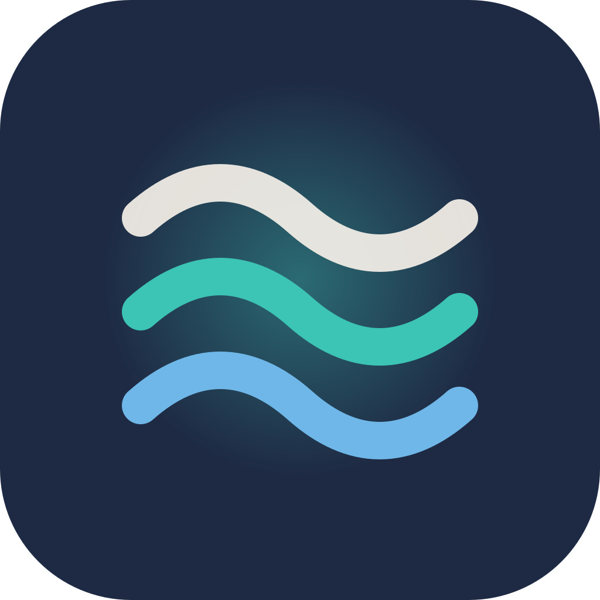
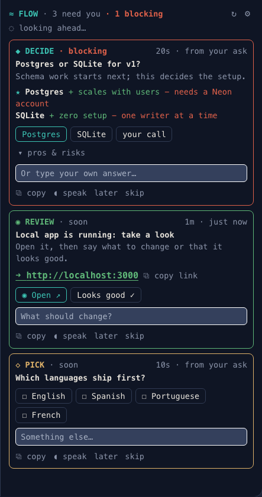

<p align="center">
  
</p>

<h1 align="center">Flow</h1>

<p align="center">
  <strong>Claude keeps building. You stay in flow.</strong><br>
  A free side panel for Claude Code that shows everything Claude needs from you, at a glance.
</p>

<p align="center">
  <a href="https://beaconfrontier.com/flow"><strong>▶ Try the live demo</strong></a>
  &nbsp;·&nbsp;
  <a href="#install">Install</a>
  &nbsp;·&nbsp;
  <a href="https://buy.stripe.com/4gMcN52qI3gQeppbsUcjS03">☕ Buy Dan a coffee</a>
</p>

<p align="center">
  
</p>

---

You're juggling several projects. You come back to a Claude Code session for thirty seconds. What does Claude need from you?

**Flow answers that in one glance.** It reads your first request, the chat so far and the project itself, then fills a panel beside the chat with cards: decisions to make, accounts to sign in to, keys to fetch, things to review. Each card has the buttons to handle it in a click and a field to type your answer. Claude picks up your answer right away, even mid-build.

## Seven kinds of asks

| | Card | What you do |
| --- | --- | --- |
| ◆ | **Decide** | A judgment call. Each option shows its pros and risks, and Claude's pick is starred. Press one, type your own, or say "your call". |
| ◇ | **Pick** | Choose one, or several, from a short list. |
| ✎ | **Tell me** | Something only you know. Type it, or dictate it. |
| ⚿ | **Sign in** | One button puts the login command in your prompt (`! vercel login`). Press Enter and it runs right there. Or it opens the sign-in page. |
| ⚷ | **API key** | Opens the exact dashboard page and copies the env var name. The key goes in your `.env` file, never into the panel. |
| ◉ | **Review** | Claude made something for you to look at: an HTML file, a local app on `localhost`, a published preview. The link is front and center, so you never have to ask for it again. |
| ▸ | **Do this** | A step only you can take, like DNS or a store console, with the right page to open. |

## Built for coming back

- **Looks ahead.** It reads your first ask, the whole chat and the project (open TODOs and TBDs, env vars in `.env.example` that have no value yet, uncommitted work) to ask now what would block Claude later.
- **Works alongside Claude.** It keeps looking while Claude builds. Answers you give mid-build join the running turn at Claude's next step, so you never wait for the turn to end.
- **Review links, automatically.** When Claude writes an HTML file, starts a dev server or publishes a preview, a review card appears instantly, without a model call.
- **Copy anything.** Every link in a card is clickable, with ⧉ copy link beside it. ⧉ copy puts the whole card on your clipboard, options and all.
- **Fits your screen.** It shows 1, 2, 3, 6, 10 or 20 cards, or fills the panel and stops at the bottom. Clear a card and the next one slides in.
- **Type or talk.** Every card has a field, and pressing Enter sends your answer to Claude immediately. ◖ speak puts the question in your prompt so you can answer with Claude Code's voice mode or macOS dictation (press fn twice).
- **Never asks for secrets.** No passwords, codes or key values. It reads env var *names*, never their values, and won't send anything you type that looks like a key.

## Install

At the prompt of a Claude Code terminal session:

```
/plugin install flow --marketplace ender1311/flow
```

Answer `y` to add the marketplace, then press Enter to install it for your user.

From a shell:

```
claude plugin install flow --marketplace ender1311/flow
```

In the Claude desktop app, where `/plugin` doesn't run: click **+** next to the prompt box, then **Plugins**, then **Add marketplace** with `ender1311/flow`, then **Add plugin**.

## Use

| Command | What it does |
| --- | --- |
| `/flow` | Opens the panel (in fullscreen it docks on the right by itself) |
| `/flow 6` | Shows at most 6 cards. `/flow fit` fills the panel |
| `/flow scan` | Looks ahead now |
| `/flow send` | Sends any answers you batched |
| `/flow stop` | Stops all new cards and look-aheads until you continue. Cards already on the panel stay and can still be answered |
| `/flow continue` | Starts Flow again (`/flow resume` and `/flow start` work too). Links Claude made while stopped are shown then |

■ stop in the panel header does the same as `/flow stop`; it turns into ▶ continue while Flow is stopped, and the choice is remembered for the next session.

⚙ in the panel sets how many cards show, when it looks ahead (**while working**, **after turns**, or **only ↻**), and whether button answers go one at a time or as a batch. Typed answers always go the moment you press Enter.

## Questions

**Does it cost anything to run?** The mod is free. Each look-ahead is one extra model call over your conversation, and most of that conversation is already cached, so it's cheap. If you'd rather it only looks when you ask, choose **only ↻** in ⚙.

**Does it slow Claude down?** No. It runs beside Claude and never blocks a tool call. If the mod itself fails, your tools and prompts carry on as if it weren't there.

**Where does it work?** In the Claude Code terminal and the Claude desktop app. The mobile app shows the cards with their buttons; it doesn't have text fields yet.

## Brand

The icon is three flowing waves (cream `#f5f0e8`, teal `#3cc4b4`, sky `#6fb7e8`) on navy `#1e2a44`. The primary color is teal `#3cc4b4` on dark backgrounds and `#0f7a70` on light backgrounds.

## Free, and staying free

Flow is made by [Beacon Frontier](https://beaconfrontier.com). If it saves you a few context switches a day, [buy Dan a coffee](https://buy.stripe.com/4gMcN52qI3gQeppbsUcjS03). It keeps the next one coming.

MIT licensed.
